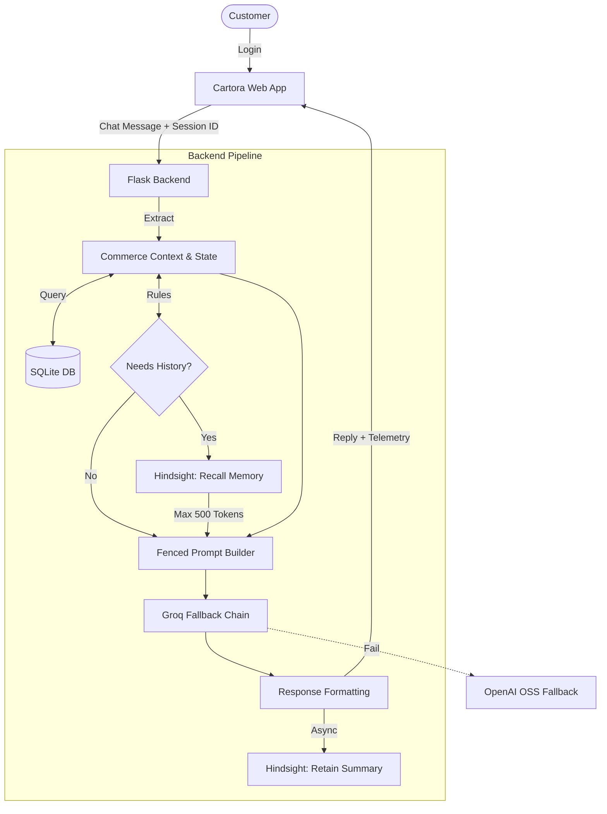

# Cartora — E-Commerce Customer Support AI

> **Shop simply. Support that remembers.**

Cartora is a fictional e-commerce portal featuring an intelligent customer support assistant powered by persistent, customer-specific conversational memory. Unlike standard chatbots that forget previous interactions once a session ends, Cartora retains context across visits—recalling preferences, past queries, order details, and resolution history to deliver personalized, proactive support.

---

## 🚀 Tech Stack

- **Backend:** Python 3.10+, Flask
- **Database:** SQLite (WAL mode)
- **LLM Engine:** Groq API (fallback chain: `gpt-oss-120b` -> `qwen3-32b` -> `llama-3.3-70b-versatile`)
- **Persistent Memory:** Hindsight Cloud (`hindsight-client`)
- **Frontend:** Responsive HTML5, Modern CSS, Vanilla JavaScript
- **Production Server:** Gunicorn (gthread workers)

---

## 🛠️ Setup Instructions

Follow these steps to run Cartora locally:

1. **Clone the repository**
   ```bash
   git clone <repository-url>
   cd CARTORA
   ```

2. **Create and activate a virtual environment**
   - On Windows (PowerShell):
     ```powershell
     python -m venv venv
     .\venv\Scripts\Activate.ps1
     ```
   - On macOS/Linux:
     ```bash
     python3 -m venv venv
     source venv/bin/activate
     ```

3. **Install dependencies**
   ```bash
   pip install -r requirements.txt
   ```

4. **Configure environment variables**
   Copy `.env.example` to `.env` and provide your API keys:
   ```bash
   cp .env.example .env
   ```
   Edit `.env` and fill in your keys:
   - `GROQ_API_KEY`: Your Groq Cloud API key.
   - `HINDSIGHT_API_KEY`: Your Hindsight Cloud API key.
   - `FLASK_SECRET_KEY`: A secure random string for session cookies.

5. **Start the application**
   For development:
   ```bash
   python app.py
   ```
   For production:
   ```bash
   gunicorn app:app --worker-class gthread --threads 4 --workers 2 --bind 0.0.0.0:5000
   ```

6. **Open in browser**
   Navigate to [http://localhost:5000](http://localhost:5000) to access the store and chat with the AI assistant.

---

## 👥 Demo Accounts

Use any of the following pre-configured demo credentials to sign in (passwords are safely hashed via `scrypt`):

| Customer Name | Email | Password | Customer ID | Tier | Location |
| :--- | :--- | :--- | :--- | :--- | :--- |
| **Maya Sharma** | `maya.sharma@cartora.example` | `CartoraDemo#1` | `C1001` | Cartora Plus | Hyderabad |
| **Arjun Verma** | `arjun.verma@cartora.example` | `CartoraDemo#2` | `C1002` | Standard | Bengaluru |

---

## 📂 Project Structure Overview

```text
CARTORA/
├── .env.example              # Template environment configuration
├── .gitignore                # Git ignore rules
├── requirements.txt          # Python dependencies
├── README.md                 # Project documentation and quickstart
├── app.py                    # Main Flask application entrypoint
├── agent/                    # AI core logic (llm client, prompts, responses)
├── memory/                   # Hindsight Cloud client and async retention loops
├── backend/                  # Application backend
│   ├── routes/               # API endpoints (Auth, Chat, Orders, Catalog)
│   └── services/             # Core business logic (Commerce, Support, DB Ops)
├── data/                     # Application data stores
│   ├── commerce.db           # SQLite WAL database (Orders, Returns, Cases, Warranties)
│   ├── demo_users.json       # Demo user credentials and mapping
│   ├── customers.json        # Customer profiles and membership tiers
│   └── products.json         # Product catalog and specifications
├── frontend/                 # Frontend assets (HTML, CSS, JS)
├── scripts/                  # Benchmarking and load-testing utilities
└── tests/                    # Pytest suites
```

---

## 🏗️ Architecture & Memory Flow



---

## ⚠️ Prototype Disclaimer

> **Note:** Cartora is a hackathon prototype built for demonstration and evaluation purposes.
> - **Authentication:** Uses simulated demo login credentials.
> - **Transactions:** All orders, prices, and tracking IDs are simulated; no real payment processing is executed.
